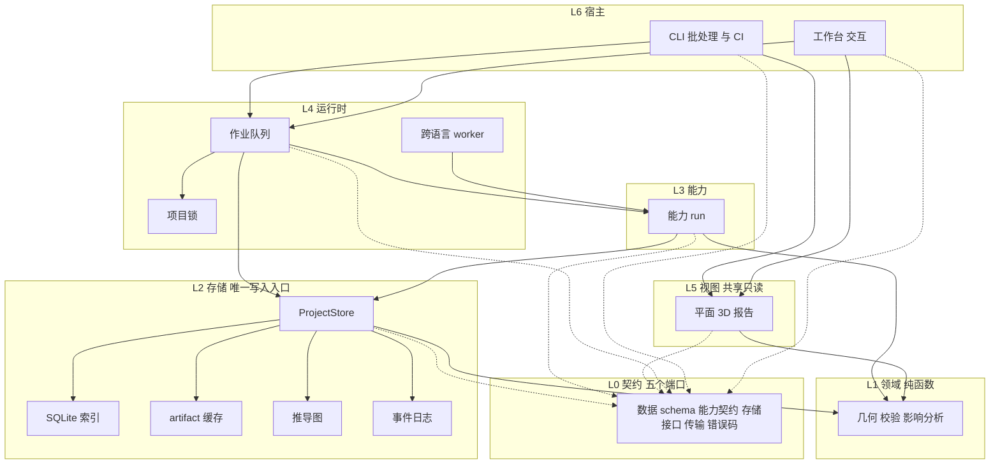
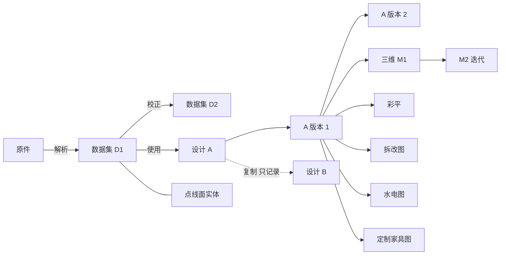

# 架构设计：分层、数据与写入

这份文档定义工具包的结构边界，供 CLI、工作台和后续扩展共同遵守。它回答三个问题：代码分几层、数据怎么存、什么算合法写入。

## 结论摘要

- **文件是事实源，SQLite 是派生索引。** 项目文件夹拷走就能交付、核对；删掉索引能重建。
- **一个项目一个库。** 索引放在项目内 `.space/project.sqlite`，不进版本库，不随交付包分发。
- **三种关系必须分开。** 派生（有依赖）、版本（同一条链）、复制（无依赖）。设计之间只允许复制，不允许派生。
- **能力只有一份实现。** CLI 与工作台都调用同一个 `run`，不为某个宿主重写业务。
- **依赖只向下。** 宿主 → 运行时 → 能力 → 存储 → 领域 → 契约；任何反向引用都视为缺陷。

## 约束

- 使用方式是单人、小团队、项目制交付，客户最终拿到的是一个文件夹。
- 原始资料是 DWG、PDF、PNG 和手机照片；几何需要解析，但解析结果可以重建。
- 工作台在本地运行，数据不出机器；交付物要能离线打开。
- 实现跨 Node 与 Python，本机还有 Blender；语言是实现细节，不是分层依据。

## 分层



### L0 契约

定义别的层必须遵守的接口，自己不含任何实现。

- 数据 schema：项目、空间模型、CAD 索引、设计版本、同步清单、版本锁，以及后续的数据集、确认记录、设计、施工图。
- 能力契约：标识、版本、阶段、参数、输入、输出、副作用、环境依赖、幂等性、错误码。
- 存储接口：读写方法签名与不变量，实现可以替换。
- 传输契约：CLI 退出码与 JSON 输出、工作台请求与事件流、worker 的消息帧。
- 错误码：数据与规则、执行与依赖、存储与并发、发布边界四类前缀。

不负责：默认值、业务判断、任何 IO。

验收方式：schema 校验用例、契约字段 lint、错误码唯一性、兼容窗口测试。

### L1 领域

纯函数层，输入数据、输出数据，不读文件、不发请求、不碰 DOM。

- 几何：多边形与洞、包围盒、面积、点在内、剖切投影、单位换算。
- 竖向：完成面、层高、净高、板厚、局部顶面、柜顶与有效顶面。
- 校验：引用完整性、标高链、门窗宿主、家具绑定、覆盖值。
- 推导规则：允许的派生边矩阵，影响面计算，失效传播。
- 差异：源图校正的逐实体差异、设计版本差异、方案对比。
- 规则检查：净空、门与柜门开启、通道宽度、拆改可行性标记。

不负责：读写、事务、并行、渲染、用户确认。确认是数据，不是计算。

验收方式：确定性测试、边界用例、大图性能（五万实体投影保持在百毫秒量级）。

### L2 存储

所有写入的唯一入口，同时管理文件、索引、推导图与事件。

- 读取：项目、数据集、设计版本、施工图定义。
- 写入：派生物原子写；数据修改走提案与乐观锁，带基准哈希。
- artifact：内容寻址，解析结果与导出包分块保存，可去重、可校验。
- 推导图：节点、边、版本链、复制记录；写入时用领域规则校验。
- 查询：实体包围盒、图层与类型、受影响节点、待复核清单。
- 事件：操作、参数、输入哈希、产物哈希、耗时与操作者。
- 重建：索引删掉后从原件与文件恢复，不重跑解析。

不负责：业务规则、调度、界面。存储不判断"这面墙能不能拆"，只判断"这条边合不合法、这次写入冲不冲突"。

三种实现：文件存储（默认）、SQLite 索引（查询与几何）、只读交付包（导出）。

验收方式：中断不留半截文件、基准哈希不一致必拒、DB 重建结果一致、同源同参数命中缓存、并发读写不损坏。

### L3 能力

一次用户可见操作的完整编排。一个能力对应一个动词和一组明确产物。

流程：校验参数 → 读输入 → 计算或调用外部工具 → 写产物 → 追加事件 → 返回摘要、产物与数据。

- 副作用必须声明：无、写派生物、写数据（需确认）、写索引。
- 幂等要声明：同输入同参数重复执行不产生重复节点。
- 进度以事件形式上报，由运行时转给宿主。
- 失败不留半成品：要么提交，要么标记为孤立并可清理。
- 外部进程通过注入的执行端口调用，能力本身不知道运行时存在。

不负责：命令解析、界面、调度、进程管理。

验收方式：无头可跑、只写允许位置、声明与实际产物一致、失败无残留。

### L4 运行时

把"执行"做好，不掺业务。

- 作业队列：提交、取消、超时、重试、并发上限。
- 项目锁：同项目串行写、读可并发；长任务在事务外计算。
- worker 协议：按行分隔的 JSON 消息，请求、进度、结果、错误四类；Python 与 Blender 共用。
- 资源管理：限定工作目录、临时文件、退出清理、进程组回收。
- 环境探测：Node、Python、Chrome、Blender 是否可用及降级策略。

验收方式：取消后无残留进程、超时能回收、worker 崩溃不影响服务、同项目并发写被串行化。

### L5 视图

把归一化数据画出来，只读。

- 平面与源图：图层过滤、尺寸标注、点击溯源、拆改叠加。
- 三维：户型白模与外部模型共用一个舞台；相机、剖切、线框、动画、统计。
- 文档：报告、问题清单、方案对比、施工图预览。
- 交互状态（选中、相机、展开）只存在本地，不写回数据。
- 同一组件支持交互模式与导出模式，导出时固定尺寸、关闭交互。

不负责：读存储、调能力、业务判断。视图只消费归一化视图数据。

验收方式：组件单测、浏览器冒烟、手机宽度、大模型帧率与内存、导出与交互一致。

### L6 宿主

两个宿主各有封装与特有能力，但都只做交互与编排。

- CLI：参数与命令、批处理、CI 退出码、JSON 输出、脚本组合；独有能力是初始化、环境自检、版本锁、发布审计、索引重建。
- 工作台：项目树、表单、进度与日志、对比与确认流程；独有能力是视口取数、逐项确认、并排对照。
- 共同红线：不直连存储写、不在宿主里实现业务规则、不为同一操作写两套实现。

验收方式：同一能力在两端产出一致；宿主里被识别出的业务规则必须下沉。

### 扩展

扩展不是第七层，而是三个接入点：

- 能力扩展：按契约注册，自动出现在 CLI 与工作台。
- 存储扩展：实现存储接口，例如只读交付包与只读全局索引（两者均已落地）。
- 界面扩展：只能挂宿主插件点，不能修改共享视图组件。

## 三种关系



- 派生：下游的输入是上游，上游变化会让下游失效。
- 版本：同一实体的第 N 次修改，属于同一条链。
- 复制：从某个方案抄一份，之后互不影响，只记录来源，不建立依赖。

规则：

- 数据集只能来自原件；校正产生新数据集，并记录差异。
- 设计只能引用一个数据集版本；设计之间不允许派生，只允许复制。
- 三维、彩平、施工图只能引用设计版本；它们之间的迭代各自成链。
- 反向依赖一律禁止：模型不能成为设计的输入，派生物不能回写数据。
- 派生节点一旦确认不可原地修改，改动产生新版本。

失效传播：上游变化时，沿边把下游标为待复核，不删除、不自动重算。工作台展示受影响清单，人确认后才产生新版本。这条规则让"校正版图纸"不会静默改掉已经交付的方案。

## 数据与存储

项目目录结构：

```
<project>/
  project.json
  source/                原件与登记清单
  data/
    datasets/<id>/      空间模型与确认记录
    designs/<方案>/      版本化设计
    documents/          施工图定义
    assets/             项目专用模型与材质
  output/               派生物，可删可重建
  docs/                 方案说明与交接
  .space/
    project.sqlite      索引、推导图、事件、几何
    cache/<hash>.json   解析产物，内容寻址
```

权威与派生：

- 原件、空间模型、确认记录、设计版本、施工图定义都是权威文件，要求可读、可 diff、可交付。
- 几何实体、包围盒索引、推导图、事件、解析缓存是派生数据，允许重建。
- 三维工程与模型文件体积大，只登记路径与哈希，不进数据库。

索引内容（示意）：

```sql
PRAGMA journal_mode=WAL;
PRAGMA foreign_keys=ON;

CREATE TABLE node (
  id TEXT PRIMARY KEY,
  project_id TEXT NOT NULL,
  kind TEXT NOT NULL,
  label TEXT,
  status TEXT NOT NULL DEFAULT 'draft',
  created_at TEXT
);

CREATE TABLE edge (
  src TEXT NOT NULL, dst TEXT NOT NULL, role TEXT NOT NULL,
  PRIMARY KEY (src, dst, role)
);

CREATE TABLE node_version (
  node TEXT NOT NULL, seq INTEGER NOT NULL, parent_seq INTEGER,
  input_hash TEXT, op TEXT, op_version TEXT, payload_path TEXT,
  PRIMARY KEY (node, seq)
);

CREATE TABLE fork (
  node TEXT PRIMARY KEY, copied_from TEXT NOT NULL, at TEXT
);

CREATE TABLE entity (
  dataset TEXT NOT NULL, handle TEXT, type TEXT, layer TEXT,
  minx REAL, maxx REAL, miny REAL, maxy REAL, geom BLOB
);

CREATE VIRTUAL TABLE entity_rtree USING rtree(id, minx, maxx, miny, maxy);

CREATE TABLE event (
  id INTEGER PRIMARY KEY, at TEXT, op TEXT, node TEXT,
  params TEXT, inputs TEXT, outputs TEXT, actor TEXT
);
```

为什么一个项目一个库：查询是项目内的，避免跨项目耦合；库能跟着项目走；删掉能重建；不需要起服务。跨项目检索以后用只读的全局索引解决，不放几何。

## 写入纪律

- 所有写入经过存储层一个入口；能力不直接写文件。
- 写文件用临时文件加改名，中断不留半截。
- 改数据必须带读取时的基准哈希，不一致拒绝并提示。
- 默认只能写派生物；改数据需要显式确认，工作台弹确认，CLI 加显式开关。
- 每次操作追加事件：能力、参数、输入哈希、产物哈希、耗时。
- 未知字段保留，schema 升级不丢扩展数据。
- 并发用 WAL 加忙等超时，同项目单写；长计算在事务外完成，提交时尽量短。

## 能力契约

一个能力需要声明：标识、版本、阶段、标题与说明、参数、输入、输出、副作用、环境依赖、幂等性、错误码，以及可选的界面入口。

```js
{
  id: 'cad.inspect',
  version: '1.0.0',
  stage: 'source',
  title: 'DXF 图元索引',
  params: [{key: 'dxf', type: 'path', required: true}],
  inputs: {dxf: 'path:dxf'},
  outputs: {index: 'cad-source/v1'},
  sideEffects: ['write:output'],
  requires: ['python:cad'],
  idempotent: true,
  errors: ['E_FILE_MISSING', 'E_PARSE'],
  run(ctx, params) {}
}
```

派生关系：

- CLI 帮助与退出码由契约生成。
- 工作台表单、按钮禁用、结果展示由契约生成。
- 存储按副作用决定权限；测试按声明核对实际产物。

## 版本与兼容

- 工具包版本：CLI 行为与能力集合。
- 数据 schema 版本：项目与数据的结构，独立演进。
- 能力版本：单个能力的行为，可与工具包不同步。
- 兼容窗口：同一大版本下相邻小版本；超出窗口时提示升级并给出迁移路径。
- 项目用版本锁记录工具版本、schema 版本与数据指纹。

## 非目标

- 不做设计派生设计，也不允许把设计当另一个设计的输入。
- 不把数据库当唯一事实源（当前阶段）；如果将来需要多人并发，再切换存储实现并配套快照导出。
- 不把三维模型、贴图、交付包塞进数据库。
- 不把生成的页面或报告当输入反读。
- 不在宿主层写业务规则，也不为 CLI 与工作台各写一套逻辑。
- 不为每个设计版本复制一份几何数据，共享 artifact。

## 决策记录

为什么不是服务端数据库：单人项目制、要能拷走文件夹、要能离线交付。服务端数据库把交付、对比、备份都变复杂，收益只在多人并发时才出现。

为什么不是纯图数据库：推导图是千级节点，递归查询在毫秒级，关系模型足够；多一套服务运维不划算。

为什么不是键值存储：需要按包围盒、按类型、按状态查询，键值引擎要自己写查询层。

为什么不是 DuckDB：列存适合跨项目统计，不适合作为频繁小事务的应用库；以后可作为只读分析挂接。

为什么文件与索引并存：几何解析慢、体积大、查询多，适合索引；确认记录与设计版本需要人读、diff、交付，适合文件。把两者混在一起，任何一边都会变差。

## 实现状态（0.7.0）

设计目标与当前实现的差距集中在这里，避免把「设计过」当成「做过」。

| 层 | 状态 |
|---|---|
| L0 契约 | 已落地：13 个模块、17 份 schema 登记、22 个错误码 |
| L1 领域 | 已落地：几何、竖向、模型校验、推导图与影响面、数据集差异、规则检查、图面渲染与投影 |
| L2 存储 | 已落地：唯一写入口、原子写、基准哈希、事件日志、内容寻址、交付清单；项目内索引与项目外全局摘要 |
| L3 能力 | 22 个已实现；3 个只有契约（`doc.mep`、`doc.furniture`、`render.interior`） |
| L4 运行时 | **部分**：项目写锁、串行写入、外部进程同步调用；作业队列、worker 协议、取消与超时回收仍只有契约（`src/contracts/transport.mjs`） |
| L5 视图 | 已落地：平面核对、白模、源图核对、交付包离线清单页与快照 |
| L6 宿主 | 已落地：CLI（34 条命令 + 通用能力门面）与本地工作台（能力表单、视口取数、确认清单） |

## 验收标准

- 契约：schema 与契约 lint 全绿；错误码无重复。
- 领域：确定性测试、边界用例、大图性能达标。
- 存储：重建一致、乐观锁生效、并发不损坏、事件完整。
- 能力：无头运行、副作用与声明一致、失败无残留。
- 运行时：取消与超时能回收、项目串行写。
- 视图：只读、组件测试、浏览器冒烟。
- 宿主：同一能力两端产出一致。
